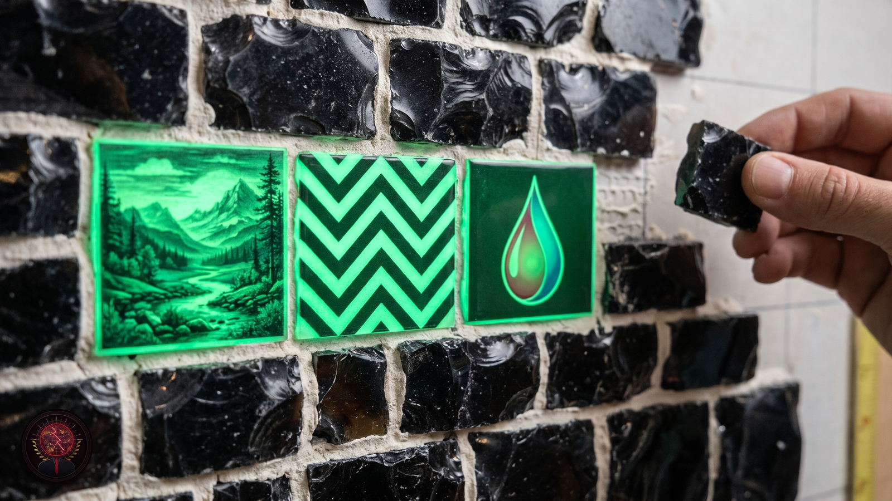
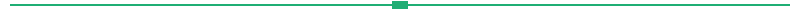
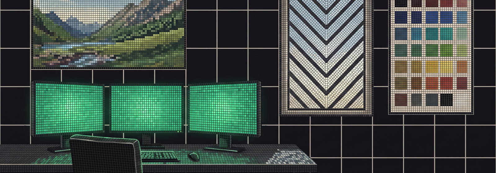

# Custom-Hacking-OS-Theming

  

<!-- deco -->
> **Grout line note:** this repo is the note above, not a theme package. There are no theme files, scripts, or install steps here.
<!-- /deco -->

**The Three Tiles**
_A mosaic in obsidian black, emerald and bone white: three tiles carry the picture, a landscape, a chevron and a single droplet of colour, and every other tile on the wall stays plain on purpose._

## Ideology for Theming

When theming a hacking OS that you didn't create, there are only three things that have to be themed, the rest should not be themed as it will be a waste of time. All the other customizations should be the hacking tools themselves.

**1. Wallpaper**

Wallpaper can be themed and changed.

<!-- deco -->
> **Grout line note:** do not get sucked into the live wallpapers, this drains system resources.
<!-- /deco -->

**2. Shell**

Theme the shell, as it is where you execute commands. The tools named for this rule are:

- Ghostty, the terminal emulator, liked for the extensive effects you can apply to it
- Fish, the preferred shell
- Fastfetch, used alongside Fish
- Something similar to powerlevel10k

**3. Color Scheme**

<!-- deco -->
> **Grout line note:** colour scheme only if it is easily changed, the way Pop!_OS Cosmic allows it to be changed.
<!-- /deco -->

## Summary

| Component | Recommended tools | What to avoid |
| --- | --- | --- |
| Wallpaper | No tool is named; the wallpaper itself is themed and changed | Live wallpapers, which drain system resources |
| Shell | Ghostty, Fish, Fastfetch, and something similar to powerlevel10k | Theming the rest of the system, which the note above calls a waste of time |
| Color Scheme | Pop!_OS Cosmic, where the colour scheme is easily changed | Changing the colour scheme where it is not easily changed |

This repo is the note above, not a theme package. There are no theme files, scripts, or install steps here; the three items above are the author's own theming rule.
