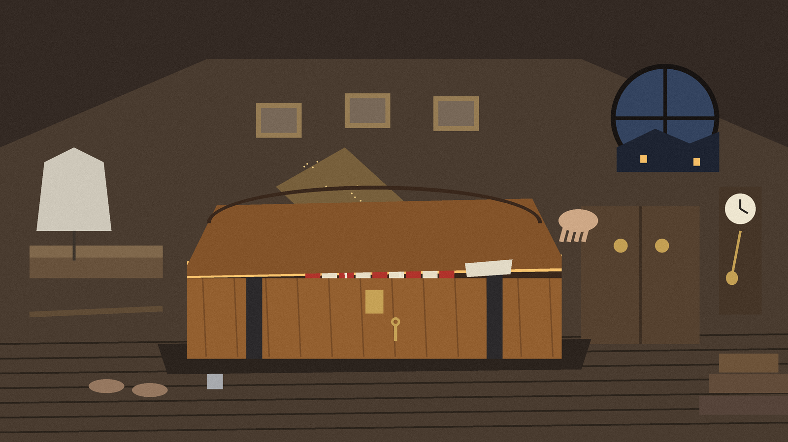
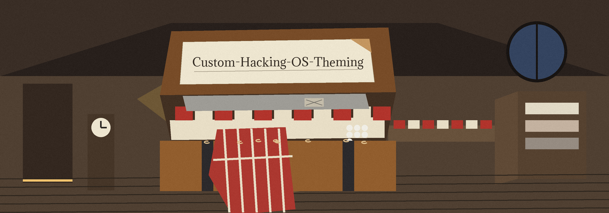
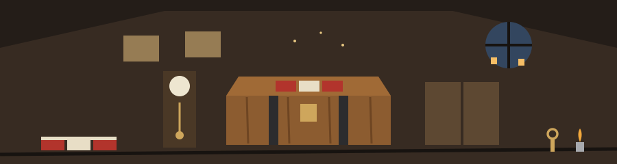

# Custom-Hacking-OS-Theming

<!-- deco -->
> Hotel register page, room held in a small cartouche at the left: THE ATTIC. A cedar trunk drawing sits beside this first plate only. Attic Trunk of Winter Blankets: a house deciding to be warm, and a note about restraint.
<!-- /deco -->

Ideology for Theming

When theming a hacking OS that you didn't create, there are only three things that have to be themed, the rest should not be themed as it will be a waste of time. All the other customizations should be the hacking tools themselves.

1. Wallpaper (Wallpaper can be themed and changed) (Do not get sucked into the live wallpapers, this drains system resources.)

<!-- deco -->
> **Label sewn into a blanket hem:** do not get sucked into the live wallpapers, this drains system resources.
<!-- /deco -->

2. Shell (Theme the shell as it is where you execute commands.) (I like ghostty emulator due to the extensive effects you can apply to it) (I also prefer using fish and fastfetch (as well as something similar to powerlevel10k))

3. Color Scheme (Only if easily changed like how Pop!_OS Cosmic allows you to)

<!-- deco -->
> **Label sewn into a blanket hem:** colour scheme only if it is easily changed, the way Pop!_OS Cosmic allows it to be changed.
<!-- /deco -->

This repo is the note above, not a theme package. There are no theme
files, scripts, or install steps here; the three items above are the
author's own theming rule.

<!-- deco -->
> **Label sewn into a blanket hem:** this repo is the note above, not a theme package. There are no theme files, scripts, or install steps here.
<!-- /deco -->
