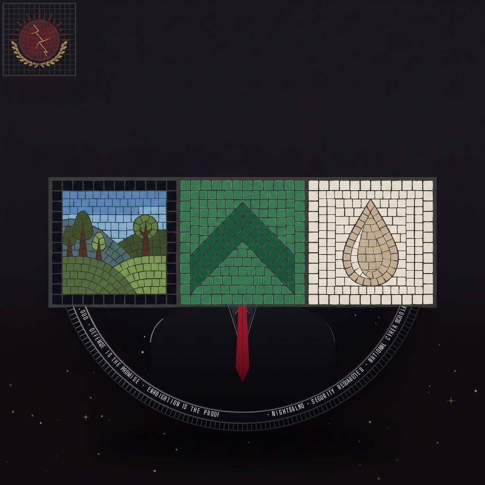

# Custom-Hacking-OS-Theming

**The Three Tiles**
_A mosaic in obsidian black, emerald and bone white: three tiles carry the picture, a landscape, a chevron and a single droplet of colour, and every other tile on the wall stays plain on purpose._

## Ideology for Theming

When theming a hacking OS that you didn't create, there are only three things that have to be themed, the rest should not be themed as it will be a waste of time. All the other customizations should be the hacking tools themselves.

1. Wallpaper (Wallpaper can be themed and changed) (Do not get sucked into the live wallpapers, this drains system resources.)

<!-- deco -->
> **Grout line note:** do not get sucked into the live wallpapers, this drains system resources.
<!-- /deco -->

2. Shell (Theme the shell as it is where you execute commands.) (I like ghostty emulator due to the extensive effects you can apply to it) (I also prefer using fish and fastfetch (as well as something similar to powerlevel10k))

3. Color Scheme (Only if easily changed like how Pop!_OS Cosmic allows you to)

<!-- deco -->
> **Grout line note:** colour scheme only if it is easily changed, the way Pop!_OS Cosmic allows it to be changed.
<!-- /deco -->

This repo is the note above, not a theme package. There are no theme
files, scripts, or install steps here; the three items above are the
author's own theming rule.

<!-- deco -->
> **Grout line note:** this repo is the note above, not a theme package. There are no theme files, scripts, or install steps here.
<!-- /deco -->
